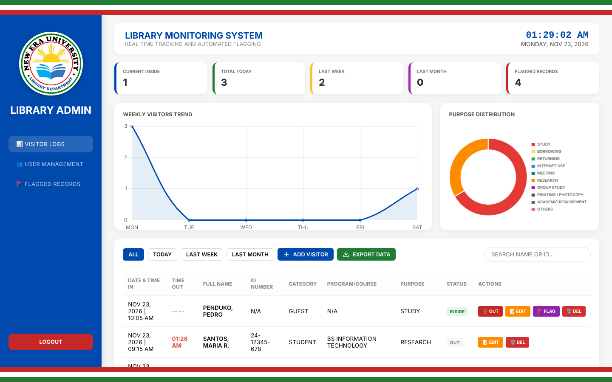
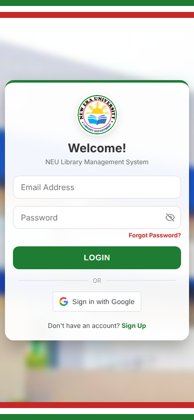
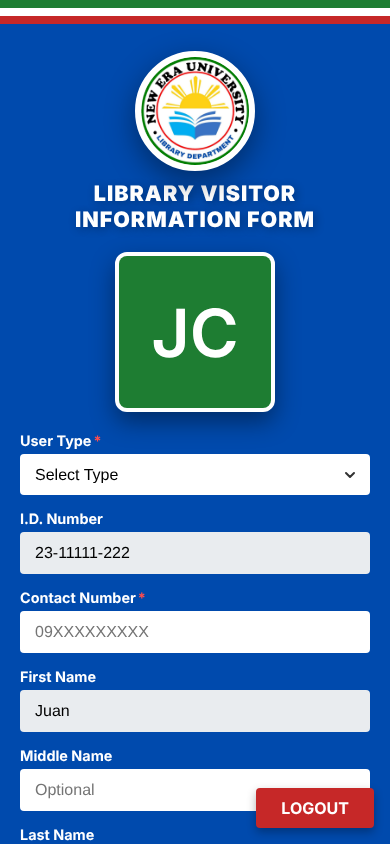
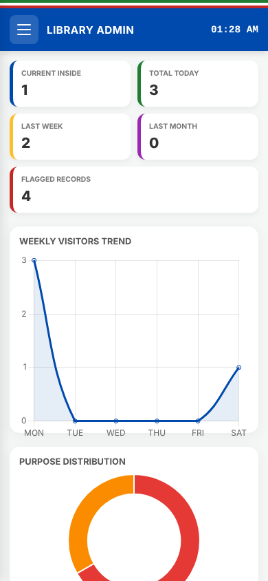
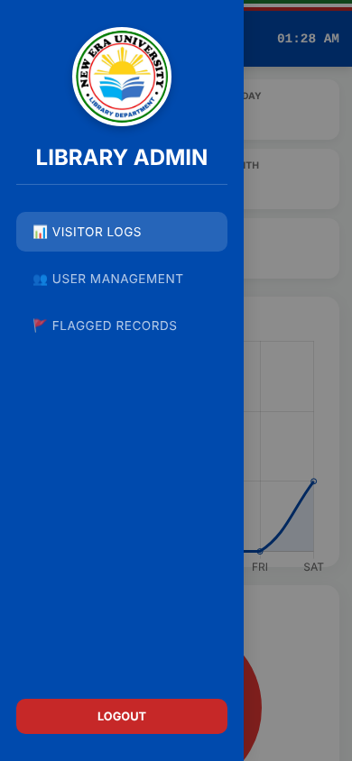
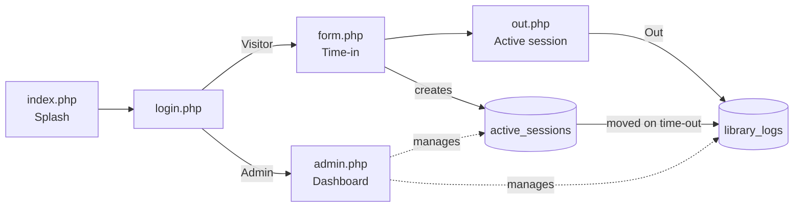

<div align="center">


# NEU Library Log

**A web-based visitor management system for the New Era University Library**

Real-time entry/exit tracking · Policy enforcement · Analytics dashboard


[**Live Demo**](https://neulibproject.page.gd/login.php)

</div>

---

## Table of Contents

- [Overview](#overview)
- [Screenshots](#screenshots)
- [Features](#features)
- [Tech Stack](#tech-stack)
- [System Flow](#system-flow)
- [Getting Started](#getting-started)
- [Configuration](#configuration)
- [Database Schema](#database-schema)
- [Project Structure](#project-structure)
- [Security](#security)
- [Author](#author)

---

## Overview

**NEU Library Log** replaces the paper logbook at the New Era University Library with a digital system. Visitors register, record their time-in with a short form, and tap **Out** when they leave. Library staff monitor everyone inside in real time, review visit history and trends, and enforce library policies through blocking and flagging.

The system was developed as a midterm project for **Information Management 2** and runs on standard PHP + MySQL hosting.

---

## Screenshots

**Admin dashboard (desktop)**



**Mobile**

| Login | Time-in form | Active session | Admin dashboard | Admin menu |
|:---:|:---:|:---:|:---:|:---:|
|  |  |  |  |  |

---

## Features

### Visitor Portal
| Feature | Description |
|---|---|
| **Account registration** | Email sign-up with an activation link, or one-tap **Google Sign-In** |
| **Time-in form** | Captures user type, ID number, program, and purpose of visit; returning visitors' IDs are remembered |
| **Active session screen** | Live clock and a single **Out** button to record time-out |
| **Real-time notices** | Visitors are informed immediately if their session is ended, their account is blocked, or they are flagged |
| **Password recovery** | Time-limited reset link delivered by email |
| **Library hours** | Visitor logins are disabled on Sundays |

### Administration Dashboard
| Feature | Description |
|---|---|
| **Live monitoring** | Current occupancy, today's visitors, last week, last month, and flagged-record counts |
| **Visit logs** | Filter by period, search by name or ID, and add, edit, time-out, or delete records, including walk-in guests |
| **Analytics** | Weekly visitor trend and purpose-of-visit distribution charts |
| **Excel export** | Download the current view as an `.xls` file |
| **User management** | Send password resets, block or unblock accounts, grant or revoke admin access, delete accounts |
| **Flagging** | Record policy violations with a reason; edit or clear flags at any time |
| **Responsive layout** | Slide-out navigation, horizontally scrollable tables, and full-width forms on phones and tablets |

---

## Tech Stack

| Layer | Technology |
|---|---|
| Backend | PHP 8 (no framework) |
| Database | MySQL / MariaDB (`mysqli`, prepared statements) |
| Authentication | PHP sessions, `password_hash`, Google Identity Services |
| Email | [PHPMailer](https://github.com/PHPMailer/PHPMailer) over Gmail SMTP (bundled) |
| Frontend | HTML5, CSS3, vanilla JavaScript |
| Libraries | [Chart.js](https://www.chartjs.org/), [SweetAlert2](https://sweetalert2.github.io/), [canvas-confetti](https://github.com/catdad/canvas-confetti) |

---

## System Flow



1. When a visitor submits the time-in form, a record is created in `active_sessions`.
2. Pressing **Out**, or an administrator timing the visitor out, moves the record to `library_logs` with the time-out.
3. While a visitor is inside, `out.php` polls `check_session.php` every few seconds to pick up administrator actions.

---

## Getting Started

### Prerequisites
- PHP **8.0+** with the `mysqli` extension
- MySQL **5.7+** or MariaDB **10.3+**
- A web server such as Apache (XAMPP / WAMP / LAMP) or any standard PHP host

### Installation

1. **Clone the repository**
   ```bash
   git clone https://github.com/NathanielCoronado/NEU-LIBRARY-LOG.git
   ```
   Place the folder in your web root (for XAMPP, `C:\xampp\htdocs\`).

2. **Create the database**

   Create an empty database (XAMPP: `neu_library` in phpMyAdmin; InfinityFree: **Control Panel → MySQL Databases**), open it in **phpMyAdmin → Import**, and select [`database.sql`](database.sql). This creates all five tables.

3. **Configure the application**
   ```bash
   cp config.example.php config.php
   ```
   Open `config.php` and fill in your values (see [Configuration](#configuration)).

4. **Run it**

   Open `http://localhost/NEU-LIBRARY-LOG/` and sign in with the admin credentials you set in `config.php`.

---

## Configuration

All environment-specific settings are in **`config.php`**, which is excluded from version control.

| Key | Description |
|---|---|
| `db.host` / `db.user` / `db.pass` / `db.name` | Database connection details |
| `admin.email` / `admin.password` | Built-in master administrator account (can log in on Sundays) |
| `mail.username` / `mail.password` | Gmail address and a [Google App Password](https://support.google.com/accounts/answer/185833) |
| `mail.from` / `mail.from_name` | Sender address and name shown on outgoing emails |
| `google_client_id` | OAuth client ID from [Google Cloud Console](https://console.cloud.google.com/apis/credentials). Add your site URL as an authorized JavaScript origin |
| `app.url` | Public base URL of the site (leave blank to auto-detect) |
| `app.secret` | Long random string used to sign verification links. Generate one with `php -r "echo bin2hex(random_bytes(32));"` |
| `app.reset_minutes` | Password-reset link validity in minutes (default `10`) |
| `app.timezone` | Default `Asia/Manila` |
| `app.debug` | Set `true` only for local debugging |

> **Important:** never commit `config.php`. It is already listed in `.gitignore`.

---

## Database Schema

| Table | Purpose |
|---|---|
| `users` | Registered accounts: profile, password hash, role (`USER`/`ADMIN`), verification and block status, reset tokens |
| `active_sessions` | Visitors currently inside the library |
| `library_logs` | Completed visits with time-in and time-out |
| `visitor_masterlist` | One profile per ID number, used when admins add walk-in visitors |
| `visitor_flags` | Policy-violation flags with reason and timestamp |

The full definition is in [`database.sql`](database.sql).

---

## Project Structure

```text
NEU-LIBRARY-LOG/
├── index.php                 # Splash screen → login
├── intro2.php                # Splash screen → sign up
├── login.php                 # Email/password login
├── signup.php                # Registration (sends activation email)
├── verify.php                # Account activation
├── forgot.php                # Request password reset
├── reset.php                 # Set new password
├── google_handler.php        # Google Sign-In endpoint
├── form.php                  # Visitor time-in form
├── out.php                   # Active session screen
├── check_session.php         # Live status polling
├── logout.php
│
├── admin.php                 # Administration dashboard
├── add_visitor.php           # ┐
├── update_process.php        # │
├── out_process.php           # │
├── delete_visitor.php        # │
├── delete_user.php           # │  Admin-only JSON endpoints
├── toggle_block.php          # │
├── update_role.php           # │
├── flag_process.php          # │
├── check_id_conflict.php     # │
├── generate_reset_link.php   # ┘
│
├── db_conn.php               # Configuration loader + database connection
├── auth.php                  # Session handling and admin access control
├── mailer.php                # PHPMailer setup and email templates
├── config.example.php        # Configuration template
├── database.sql              # Database schema
│
├── admin.css                 # Dashboard styles
├── responsive.css            # Shared mobile styles for public pages
├── neu-logo.jpg · neu-library.jpg · favicon.ico
├── PHPMailer/                # Bundled PHPMailer library (LGPL-2.1)
└── docs/screenshots/         # README images
```

---

## Security

- **Credentials:** passwords are stored with `password_hash()`. Secrets are kept in an untracked `config.php`.
- **SQL injection:** every query that takes user input uses prepared statements.
- **Access control:** the dashboard and every administrative endpoint check for a valid admin session on each request.
- **Email verification:** activation links are HMAC-signed and expire after 24 hours.
- **Password reset:** tokens are random, time-limited, single-use, and checked again when the form is submitted.
- **Google Sign-In:** ID tokens are checked against the application's own client ID.
- **Privacy:** visitors only receive notifications about their own flags.
- **Sessions:** cookies are `HttpOnly` and `SameSite=Lax`, and the session ID is regenerated on login.

---

## Author

**Nathaniel Coronado**
New Era University, Information Management 2

[](https://github.com/NathanielCoronado)
